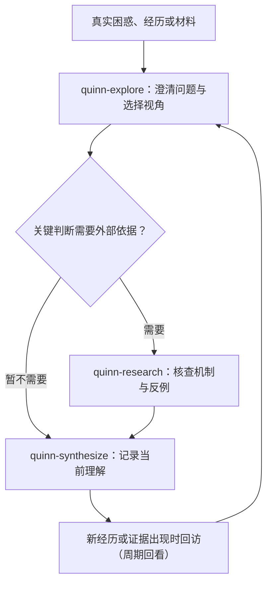

# Quinn 产品契约

日期：2026-09-25  
状态：现行。Quinn「服务什么问题、默认如何开始、什么算一次有效结果」的唯一产品真源。

实现细节见主线实现方案与数据契约，本页只定产品边界，不重复字段与交互协议。

## 1. Quinn 服务什么问题

从用户的真实困惑、经历或材料出发，接触不同解释和跨领域机制，共同形成新理解、新问题和可尝试的机会。帮助的是宏观思考、跨领域连接和判断。

此外，围绕用户的真实任务提供个人能力实践教练（`quinn-practice`）：明确能力目标 → 尝试或示范 → 针对性反馈 → 再次尝试 → 实际应用 → 新场景迁移。训练记录结构化，但**不打分、不设能力等级**；模型示范与任务协助输出不计为独立能力证据，不把 AI 生成成果算成用户已学会。

Quinn 不做脱离真实任务的出题训练。思维练习（`quinn-brainstorming`）是用户主动发起的可选练习，见 §6。

## 2. 默认如何开始

默认按用户意图分两条路径，不按固定顺序跑 Skill：

- **探索路径（理解困惑）**——默认从探索开始（`quinn-explore` 判断卡点），按问题调用另外两个职责：
  - 只缺事实 → `quinn-research` 核查
  - 已想清楚 → `quinn-synthesize` 保存 / 总结
  - 需要换角度 → `quinn-explore` 探索
- **实践教练路径（把学到的方法用到正在做的事）**——`quinn-practice` 承接三个入口，`workspace/config.md` 的 `practice: off` 时退回落探索：
  1. 我有一个正在解决的问题。
  2. 我想练会一种方法或技能。
  3. 我学了一些内容，想检查能不能用。

  三种交付模式（学习练习 / 示范起步 / 任务协助）随时切换；任务协助优先交付结果，但其输出不算独立能力证据。

## 3. 主线关系

## 4. 三种能力的归位

| 能力 | 在主线中的角色 |
| --- | --- |
| 经历复盘 | 输入来源 |
| 框架转换 | 探索动作 |
| 周期回看 | 跨会话动作 |

三者复用同一套来源归属、用户纠正和保存机制，不各建入口、不新增 Skill。

## 5. 什么算一次有效结果

- 提出了更准确的问题；
- 发现了有效反例；
- 在新材料出现后修正了判断。

允许确认原判断、澄清事实、暂无结论。有趣的类比若没有改变判断，只算灵感、不沉淀为结论。开放探索不打分。

## 6. 思维练习（可选）

`quinn-brainstorming` 是用户主动要求时的可选练习，不属于默认主线：围绕真实困惑或初步想法生成一组书写问题，按需给思路建议与分级提示，帮助用户练习思维并看见理解变化。不打分、不设能力等级、不根据沉默或错误次数推断能力；记录只用描述态。复用同一套来源归属、用户纠正和保存机制；事实核验转 `quinn-research`，保存由 `quinn-synthesize` 完成。不同于 §4 的三个核心能力，它作为独立入口存在。

`quinn-practice` 是围绕真实任务的结构化训练闭环（§2 实践教练路径），与 `quinn-brainstorming` 的书写练习是两条不同的路径：前者针对真实任务做能力训练并落结构化记录（`workspace/goals|training_sessions|attempts|feedback/`，见数据契约 §10），后者是可选的思维书写练习、记录在 session 正文。

## 7. 旧方案

「AI 商业与产品判断训练伙伴」（单 Skill、案例、评分、等级）为历史方案，已被本契约取代；原文保留在 `docs/Quinn-Research-Strategy-Implementation-Plan.md` 供对照。
